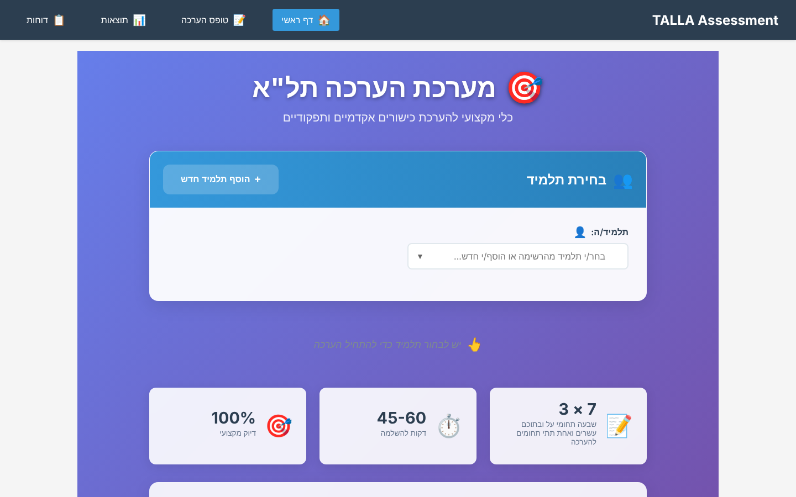
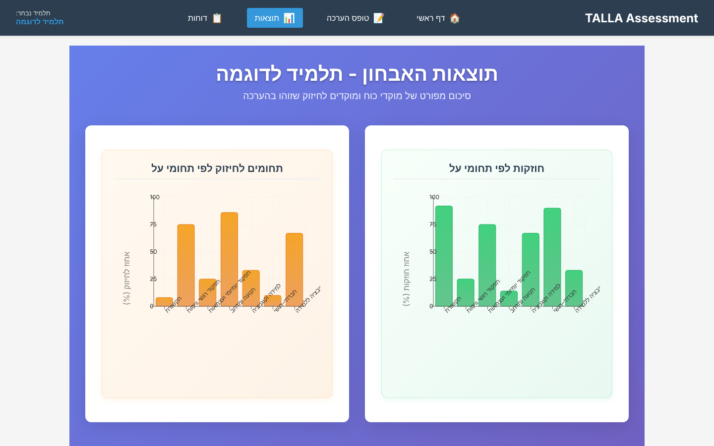

# TALLA – IEP Assessment & Report Builder

A tool for special education teachers that helps build an Individualized Education Program (IEP, in Hebrew: תל"א). The teacher assesses a student against a structured bank of strength and difficulty statements, sees the results as charts, and gets a draft report written by AI. The interface is in Hebrew (RTL).

Built from my own experience as a special education teacher: writing these programs by hand takes hours for every student.





## Features

- **Students** – add students and pick the student to assess
- **Structured assessment form** – 7 domains and 21 sub-domains (communication, emotional regulation, daily functioning, movement, learning, social-emotional, self and motivation); each statement is marked as a strength or a difficulty
- **Results dashboard** – charts of strengths and difficulties per domain and the top sub-domains (Recharts)
- **AI report** – an Express server sends the assessment to OpenAI (gpt-4o-mini) and returns a written draft report; the API key stays on the server

## Tech Stack

**Frontend:** React 19 · TypeScript · Redux Toolkit · React Router · Recharts · Vite
**Backend:** Node.js · Express · OpenAI API

## Run Locally

**Requirements:** Node.js 20+, an OpenAI API key (for the report only)

1. Server:
   ```bash
   cd server
   npm install
   copy .env.example .env        # set OPENAI_API_KEY
   npm run dev                   # http://localhost:3001
   ```
2. App (from the project root):
   ```bash
   npm install
   copy .env.example .env
   npm run dev                   # http://localhost:5173
   ```

The assessment form and the charts work without the server; only the AI report needs it.

## What I Learned

- Turning domain knowledge from special education into a data model and a usable interface
- Managing complex form state with Redux Toolkit
- Prompting an LLM from the server to produce a structured professional document

## Author

Yuval Dromi · [GitHub](https://github.com/yuvaldromi1)
